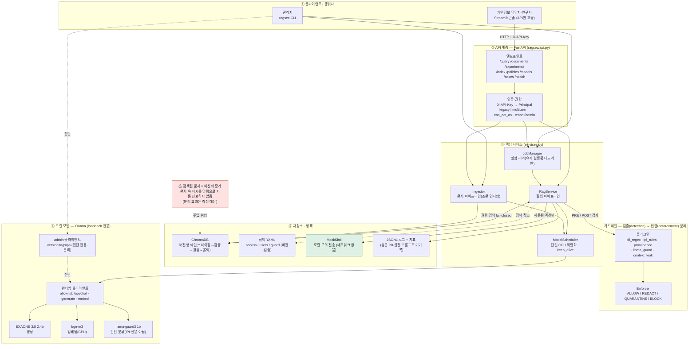

# ragsec 전체 시스템 구성도

> 편집 가능한 Mermaid 원본(아래) — GitHub에서 바로 렌더링됩니다. 인쇄/오프라인 공유용 PDF는 같은 폴더의
> `ragsec_시스템_구성도.pdf`. 모든 데이터는 합성이며 외부 전송은 로컬 모의 싱크로만 갑니다.

## 핵심 흐름 (한눈에)

- **질의:** 클라이언트 → FastAPI(인증·권한) → RagService → 권한 검색(ChromaDB, fail-closed) → PRE 검사 →
  컨텍스트 조립(근거 라벨 `[E#]`) → 생성(Ollama) → **액션 파싱(미실행) → 출력/인용 검사 → 액션 인가 →
  허용된 모의 액션만 실행** → 응답 + JSONL 로깅.
- **문서:** 제출 → 메타데이터 검증 → 파싱/정규화 → 수집 훅(플래그) → 청크/임베딩 → 스테이징 색인 → 검증 → 활성화.
- **실험:** 검토된 케이스 → 버전형 데이터셋 → manifest 검증 → freeze 검증 → 유계 쌍대 실행 → 기록 → 집계.

## 신뢰 경계 (요약)

- **신뢰:** `SYSTEM_PROMPT`·정책 YAML·`ollama_url`(loopback 검증) 등 서버 설정 / 인증된 주체 신원.
- **비신뢰:** 검색된 문서 내용·질의 텍스트. 문서 속 "지시"는 명령이 아니며, `<document>`로 감싸 분리합니다.
- **분리 축:** 가드 검출 ≠ 집행, egress 차단 ≠ LLM 방어, 출처 인용 ≠ 의미적 정확성, 루프백 ≠ 인증.

## 범례

- ①~⑥ = 계층. 실선 = 주 데이터/제어 흐름, 점선 = 진단/정책 참조/주입 위험.
- 초록(MockSink) = 안전 경계(실제 네트워크 없음), 빨강(비신뢰) = 공격 표면.
